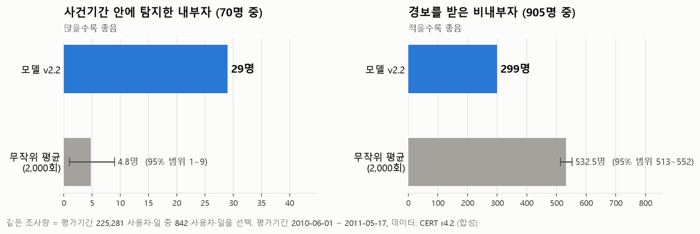
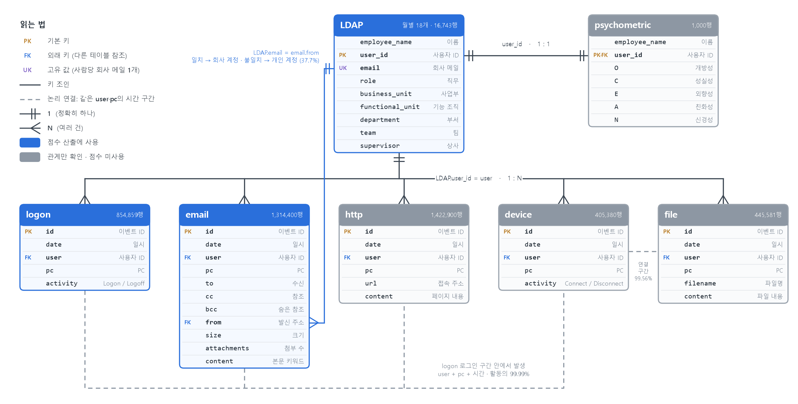
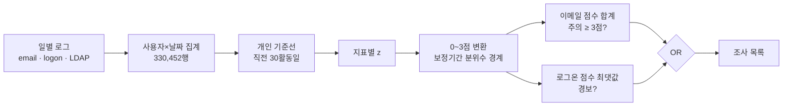
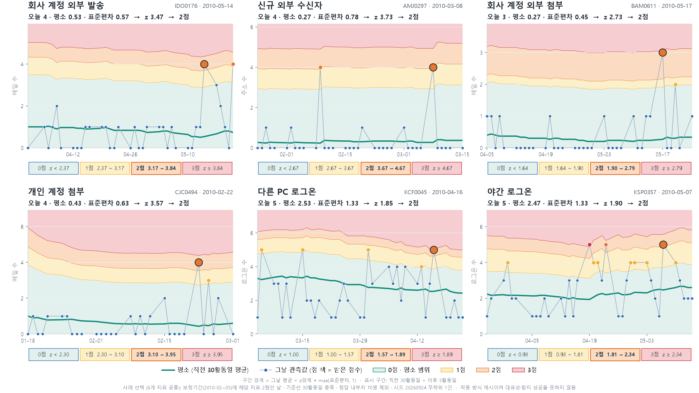
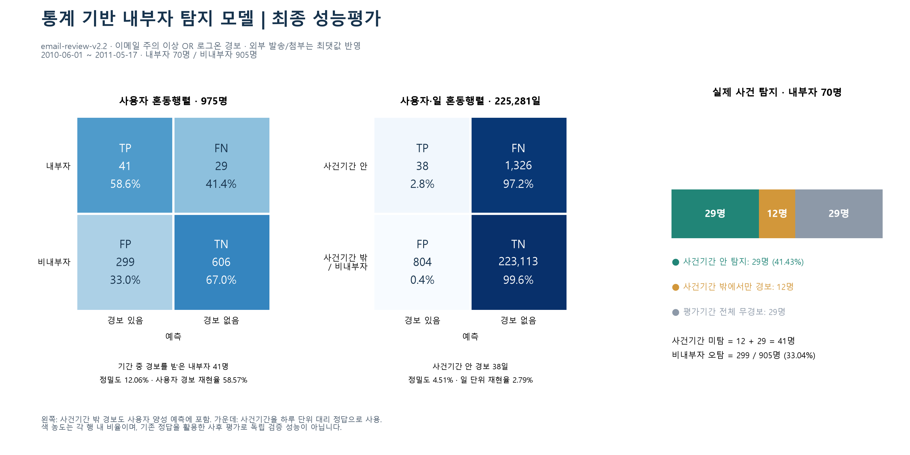
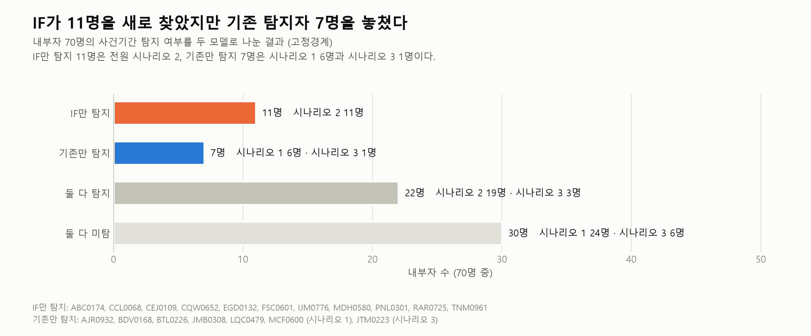
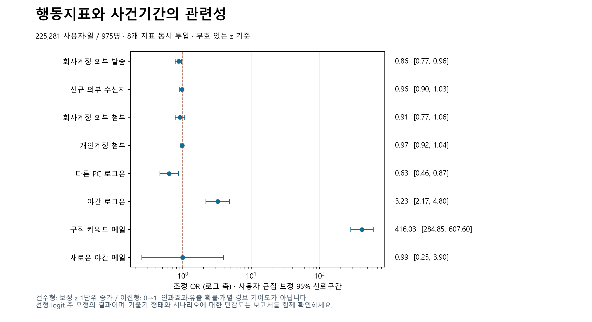

# 정답 없이 설계한 이메일 외부유출 위험 스코어링

> 보안 로그 약 440만 건(사용자 1,000명)에서 **평소와 다른 외부 메일 행동**을 개인 기준선 z-score로 점수화해, 보안 담당자가 매일 조사할 사람을 추리는 데이터 분석 프로젝트입니다.
> 신호가 있는 곳에서는 작동했고, 신호가 없는 곳에서는 왜 안 되는지를 데이터로 증명했습니다.

| 항목 | 내용 |
|---|---|
| 유형 | 개인 프로젝트 |
| 기간 | 2026.09 |
| 데이터 | CERT Insider Threat r4.2 (합성 보안 로그) · 사용자 1,000명 · 약 16.5개월 · 이메일 131만 건 · 로그온 85만 건 |
| 기술 | Python · pandas · NumPy · SciPy · scikit-learn (Isolation Forest) · Matplotlib · Streamlit · Plotly |
| 핵심 | 비지도 이상 점수 설계 · 극단적 불균형 데이터 평가 · 같은 조사량 비교 · 과적합 방지 의사결정 |

### ▶ [대시보드 바로 보기](https://teirencloud-qc3nzy5td7toothhq4cgdx.streamlit.app/user)

---

## 한눈에 보기

| 같은 조사량에서 무작위 대비 | 전체 사용자·일 중 경보 비율 | 구직 후 유출 시나리오 탐지율 |
|:---:|:---:|:---:|
| **내부자 약 6배 탐지** (29명 vs 4.8명) | **0.37%** (하루 평균 약 2.4건) | **63%** (30명 중 19명) |



- 평가기간(2010-06 ~ 2011-05) 225,281 사용자·일 중 모델과 같은 842 사용자·일을 무작위로 2,000번 뽑았을 때, 모델의 29명 이상을 찾은 경우는 **0회**였습니다.
- 한계도 함께 밝힙니다. 사건기간 탐지율은 **41% (70명 중 29명)** 입니다. 정답 70명 중 30명은 이메일 흔적이 없는 시나리오였습니다. → [6. 한계](#6-한계와-실제-환경이라면)

---

## 1. 문제 정의

국내 기술유출 사례는 **"이직 준비 → 외부·개인 메일로 반출 → 수개월 반복"** 패턴을 보입니다. 보안 담당자에게 필요한 것은 정확한 분류기가 아니라 **매일 확인할 짧은 조사 목록**과 **"왜 이 사람인가"라는 이유**입니다.

- **분석 질문:** 평소와 다른 외부 전송 행동을, 적은 조사량으로 포착할 수 있는가?
- **목표:** 분류 정확도가 아니라 조사 우선순위. 적은 경보와 설명 가능한 이유가 필요합니다.
- **설계 원칙:** 실제 현장에는 정답 라벨이 거의 없습니다. 그래서 **정답은 평가에만 쓰고**, 지표와 경계는 데이터 분포만으로 정했습니다.

## 2. 데이터와 먼저 확인한 제약



로그 7종을 사용자 ID로 연결했습니다. 점수에는 **LDAP · logon · email** 3종만 사용했습니다(파란 헤더).

| 로그 | 규모 | 사용 여부 |
|---|---:|---|
| email | 1,314,400행 | ✅ 핵심. 발신 주소를 LDAP 회사 메일과 비교해 회사 계정과 개인 계정(37.7%)으로 구분 |
| logon | 854,859행 | ✅ 다른 PC 로그온, 야간 로그온 |
| LDAP | 16,743행 (월별 18개) | ✅ 회사 메일, 직무, 부서 |
| http / device / file / psychometric | 142만 / 40만 / 44만 / 1,000행 | ❌ 관계만 확인. USB 로그는 약 265명에게만 있어 전사 지표로 쓰기 어려움 |

가공 결과는 사용자×날짜 330,452행입니다. 기준선 조건(과거 활동일 10일 이상, 첫 활동 후 30일 이상)을 채우지 못한 22,429행은 0점으로 처리하지 않고 **제외**했습니다.

**분석 전에 문서화한 제약: 문제와 정답이 어긋나 있습니다.**

| 정답 시나리오 | 인원 | 실제 행동 | 이메일로 탐지 가능? |
|---|---:|---|---|
| 1 | 30명 | 야간 로그온 + USB 반출 | ❌ 이메일 흔적 없음 |
| 2 | 30명 | 구직 활동 후 USB 반출 | △ 구직 메일로 간접 탐지 |
| 3 | 10명 | 타인 계정으로 메일 발송 (전원 IT 관리자) | △ 타인 계정 기록 |

- 이메일로 잡을 수 있는 내부자는 **이론상 최대 40명**입니다.
- 국내에서 가장 흔한 유형인 "회사 메일 → 본인 개인 메일" 전송은 이 데이터에 **0건**입니다.
- 사건기간 전체를 양성으로 보면 양성 사용자·일은 **0.61%** 입니다.

→ 상세: [analysis/01_data_and_constraints](analysis/01_data_and_constraints)

## 3. 방법: 정답 없이 "평소와 다른 하루"를 찾는다



**개인 기준선과 점수**
- `z = (오늘 값 − 직전 30활동일 평균) / max(직전 30활동일 표준편차, 1)`. 당일은 기준선에서 제외합니다.
- 보정기간(2010년 1~5월) z 분포의 99% / 99.75% / 99.95% 분위수를 1 / 2 / 3점 경계로 정하고, 이후에는 고정합니다.

**행동지표 8개.** 세 가지 기준으로 골랐습니다. ① 국내 유출 사고 행동과 관련이 있을 것 ② 평소와 이상일이 분포에서 구분될 것 ③ 지표끼리 겹치지 않을 것 (VIF 1.00~1.54).

| 유형 | 지표 | 점수 방식 |
|---|---|---|
| 이메일 핵심 | 회사 계정 외부 발송 · 신규 외부 수신자 · 회사 계정 외부 첨부 · 개인 계정 첨부 | 개인 기준선 z → 0~3점 |
| 이메일 규칙 | 구직 키워드 메일 (한 통에 3개 이상 → 2점) · 새로운 야간 메일 (평소 없다가 등장 → 1점) | 규칙 |
| 로그온 | 다른 PC 로그온 · 야간 로그온 | 개인 기준선 z → 0~3점 |



**경보 정책**
- 이메일 점수는 지표별 점수를 더합니다. 단, 외부 발송과 외부 첨부는 포함 관계라 둘 중 큰 값 하나만 반영합니다. 관심 ≥ 2, **주의 ≥ 3**, 위험 ≥ 5입니다.
- 로그온은 두 지표 중 최댓값을 씁니다. 3점이거나, 2점이면서 z ≥ 1.9443이면 경보입니다.
- **조사 대상 = 이메일 주의 이상 OR 로그온 경보.** 두 채널 점수는 더하지 않습니다(→ [5. 의사결정](#5-의사결정-더-높은-숫자를-세-번-거절했다)).

**가중치를 정답에 맞추지 않은 이유:** 이메일로 잡을 수 있는 내부자가 40명뿐입니다. 정답에 맞춘 가중치는 이 40명에게만 맞을 뿐, 새 데이터에서 더 잘 잡는다는 근거가 없습니다.

→ 상세: [analysis/02_indicator_design](analysis/02_indicator_design) · [analysis/03_scoring_policy](analysis/03_scoring_policy)

## 4. 평가: 좋아 보이는 숫자를 먼저 걸러냈다

이 데이터에서는 **아무도 경보하지 않는 모델의 정확도가 99.39%** 입니다. 우리 모델(99.05%)보다 높습니다. 그래서 평가를 설계할 때 숫자가 부풀려질 수 있는 경로 다섯 가지를 먼저 막았습니다.

| 함정 | 대응 |
|---|---|
| 정확도가 극단적 불균형에서 무의미함 | 사건기간 탐지 인원, 오탐 인원, **같은 조사량 비교**를 주 지표로 사용 |
| 경계를 정한 기간으로 성능을 재면 부풀려짐 | 보정기간(2010.01~05)과 평가기간(2010.06~2011.05) 분리 |
| 사건 전후의 경보도 "탐지"로 셀 수 있음 | 사건 시작~종료일 안의 경보만 탐지로 인정 (사용자 경보 58.6% → 사건 탐지 41.4%) |
| 경보를 많이 낼수록 탐지가 느는 착시 | 모든 모델 비교를 같은 조사량(842 사용자·일)으로 맞춤 |
| 평가기간에 기록 없는 사람을 정상(TN)으로 셈 | 평가기간에 활동한 975명만 분모로 사용 |



**어디서 잡고 어디서 놓쳤나**

| 시나리오 | 사건기간 탐지 | 탐지율 |
|---|---:|---:|
| 1. 야간 로그온 + USB | 6 / 30 | 20.0% |
| 2. 구직 후 반출 | **19 / 30** | **63.3%** |
| 3. 타인 계정 메일 | 4 / 10 | 40.0% |

- 이메일 채널이 19명, 로그온 채널이 10명을 찾았고 **두 집합은 겹치지 않습니다.** 로그온이 이메일의 빈틈을 보완합니다.
- 탐지율 차이는 모델보다 **데이터에 신호가 있느냐**로 설명됩니다.

→ 상세: [analysis/04_evaluation](analysis/04_evaluation)

## 5. 의사결정: 더 높은 숫자를 세 번 거절했다

개선처럼 보인 결과 세 가지를 검증했고, 모두 채택하지 않았습니다.

| 후보 | 겉보기 개선 | 검증 결과 | 결정 |
|---|---|---|---|
| **Isolation Forest로 교체** | 탐지 29 → 33명, 오탐 299 → 257명 | 시나리오 1은 전원 놓침. 기존 탐지자 7명을 잃음. 경보 이유를 설명할 수 없음 | 미채택 |
| **직무 보정 강도 튜닝** | 개발용 데이터에서 w=0.75가 상위 25명 중 내부자 9명 (기존 8명) | 미리 고정한 평가용 데이터에서는 **7명 vs 8명으로 역전** | 미채택 (과적합) |
| **이메일 + 로그온 점수 합산** | 하나의 점수로 단순화 | 같은 조사량에서 탐지 29 → 25.3명, 오탐 299 → 337명 | 미채택 |

**Isolation Forest가 4명 더 찾은 이유를 두 가지 방법으로 분해했습니다**
1. **경보 분해:** IF만 찾은 내부자 11명은 전원 시나리오 2였습니다. IF의 사건기간 이메일 경보 127일 중 123일에 구직 키워드가 있었습니다.
2. **로지스틱 회귀 (해석용, 정답 사용):** 구직 키워드의 OR은 416 (95% CI 285~608)입니다. 이 지표를 빼면 pseudo-R²가 0.069에서 0.006으로 떨어집니다. 나머지 이메일 z 지표 4개의 OR은 ≈ 1이었습니다. 표준오차는 사용자 단위 군집 보정을 했습니다.

→ 성능 차이는 알고리즘이 아니라 **구직 키워드라는 신호 하나**에서 나왔습니다. 이는 합성 데이터의 시나리오 설계를 반영한 결과입니다. 로지스틱 결과로 가중치를 정하자는 안도 거절했습니다. 정답을 보고 가중치를 정한 뒤 같은 정답으로 평가하면, 답을 보고 시험을 치는 것과 같기 때문입니다.

| IF와 기존 모델의 내부자 탐지 변화 | 지표별 OR과 95% 신뢰구간 |
|:---:|:---:|
|  |  |

직무 보정 실험은 **개발용 데이터로 채점하기 전에 계획과 평가 기준을 파일로 고정하고 해시를 기록**한 뒤 진행했습니다.

→ 상세: [analysis/05_model_comparison](analysis/05_model_comparison) · [analysis/06_rejected_alternatives](analysis/06_rejected_alternatives) · [의사결정 기록](docs/decisions.md)

## 6. 한계와 실제 환경이라면

**한계**
- 합성 데이터이고, 정답이 이메일 유출 전용이 아닙니다. 수치는 CERT r4.2 기준으로만 해석해야 합니다.
- 정답을 본 뒤 지표와 정책을 검토한 이력이 있어 완전한 독립 홀드아웃이 아닙니다. 특히 구직 키워드 사전이 그렇습니다.
- 직무 보정이 없어 로그온 경보의 89%가 IT 관리자에게 몰립니다.
- 30일 기준선은 조금씩 오래 반출하면 기준선도 함께 올라가 놓칠 수 있습니다.

**실제 데이터라면 추가하고 싶은 것**

| 데이터 | 이유 |
|---|---|
| 회사 메일 → 본인 개인 메일 전송 | 국내 사고에서 가장 흔한 유형인데, 이 데이터에는 0건 |
| 첨부 파일의 민감도와 크기 | 무엇을 보냈는지 알 수 있음 |
| 퇴사·인사 이벤트 | 이직 준비 신호를 구직 키워드보다 직접 확인 |
| 조사 결과 피드백 | 담당자의 판정으로 경계를 운영하면서 검증 |

## 7. 결과물: 보안 담당자용 대시보드

### ▶ [대시보드 바로 보기](https://teirencloud-qc3nzy5td7toothhq4cgdx.streamlit.app/user)

"오늘 누구를, 왜 조사해야 하는가"에 화면 네 개로 답합니다.

| 화면 | 담당자가 하는 일 |
|---|---|
| 대시보드 | 오늘의 경보 건수, 조사 대상 수, 채널별 현황 파악 |
| 위험도 랭킹 | 조사 우선순위 목록 확인 |
| 사용자 분석 | 한 사람의 오늘 값, 평소 평균, z, 지표별 점수, 점수 추이로 "왜 위험한가" 확인 |
| 점수·등급 기준 | 경계와 정책을 투명하게 공개 |

점수만이 아니라 지표별 근거("평소 0.5건 → 오늘 4건")를 보여줍니다. 모델을 고를 때 설명 가능성을 우선한 이유가 여기에 있습니다. 코드: [dashboard/](dashboard)

## 8. 배운 점

1. **평가 기준을 먼저 정하면 결과에 흔들리지 않는다.** 같은 조사량 비교를 미리 정해 두었기 때문에 IF의 4명 개선도 냉정하게 볼 수 있었습니다.
2. **개선을 보면 원인부터 분해한다.** "IF가 더 좋다"에서 멈추지 않고 "어떤 신호 때문에"를 물었고, 서로 다른 두 방법으로 같은 답을 확인했습니다.
3. **분할 검증은 비용이 아니라 보험이다.** 개발용에서만 이긴 설정을 걸러냈습니다.
4. **데이터의 한계를 먼저 문서화하면 낮은 성능도 설명할 수 있다.**

---

## 저장소 구조

```
├── analysis/                     분석 단계별 보고서 · 코드 · 요약 결과
│   ├── 01_data_and_constraints/  데이터 관계, 사용 데이터 선택, 정답과 문제의 어긋남
│   ├── 02_indicator_design/      행동지표 8개 선정 근거, 상관·VIF, 사내 수신자 제외 실험
│   ├── 03_scoring_policy/        개인 기준선, 점수 경계 보정, 가중치 원칙
│   ├── 04_evaluation/            혼동행렬, 사건기간 탐지, 무작위 기준선
│   ├── 05_model_comparison/      Isolation Forest 비교, 로지스틱 회귀 해석
│   └── 06_rejected_alternatives/ 직무 보정 분할 검증, 채널 점수 합산 실험
├── src/pipelines/                사용자×날짜 집계와 30일 기준선 데이터셋 생성
├── src/scoring/                  점수·등급·경보 정책 (email-review-v2.2)
├── dashboard/                    Streamlit 대시보드 코드
├── docs/                         의사결정 기록, 컬럼 정의서
├── data/                         원본 데이터 받는 방법 (데이터 미포함)
└── images/                       README 그림
```

## 재현 방법

원본 데이터는 라이선스상 재배포할 수 없어 저장소에 넣지 않았습니다. 받는 방법은 [data/README.md](data/README.md)에 있습니다.

```bash
pip install -r requirements.txt

# 1) 사용자×날짜 집계 → 2) 직전 30일 기준선 데이터셋
python src/pipelines/build_user_day_ldap_logon_email.py
python src/pipelines/build_user_day_baseline_30.py
# 3) 점수·등급 산출 (정답 미사용) → 대시보드 입력
python src/scoring/prepare_data.py

# README의 모델 vs 무작위 그림 (저장소에 포함된 요약 CSV로 바로 실행 가능)
python analysis/04_evaluation/random_baseline/plot_random_baseline.py
```

각 `analysis/` 폴더의 스크립트는 작업 당시의 폴더 구조(`inputs/`, `outputs/`, `labels/`)를 기준으로 작성되어 있습니다. 원본 데이터를 받은 뒤 경로를 맞춰 실행하세요.

## 데이터 출처

CERT Insider Threat Test Dataset r4.2, Carnegie Mellon University Software Engineering Institute ([KiltHub](https://kilthub.cmu.edu/articles/dataset/Insider_Threat_Test_Dataset/12841247)).
그림에 나오는 사용자 ID와 수치는 이 합성 데이터에서 나온 것입니다. Copyright © 2011 ExactData, LLC, All Rights Reserved.
