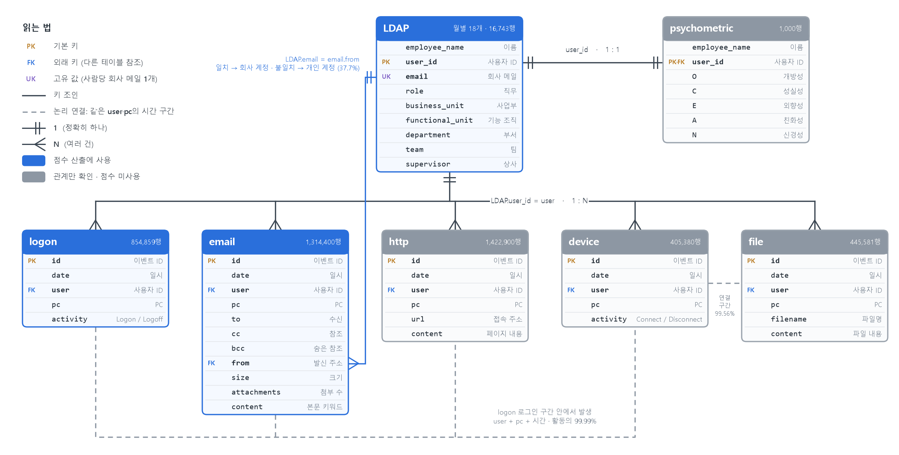

# 01. 데이터와 제약

로그 7종의 관계를 확인하고 점수에 쓸 데이터를 골랐습니다. 분석 전에 "정답이 이메일 유출 전용이 아니다"라는 제약을 문서화했습니다.

**핵심 결과**
- 7종 중 **LDAP · logon · email** 3종만 점수에 사용합니다. USB(device) 로그는 약 265명에게만 있어 전사 지표로 쓰기 어렵습니다.
- 이메일 발신 주소를 LDAP 회사 메일과 비교해 회사 계정과 개인 계정(37.7%)을 구분했습니다.
- 정답 70명 중 이메일로 잡을 수 있는 인원은 **이론상 최대 40명**입니다(시나리오 1의 30명은 이메일 흔적 없음).

| 파일 | 내용 |
|---|---|
| [data_relationships.md](data_relationships.md) | 로그 7종의 키와 연결 관계, LDAP 변화, 연결 가능성 |
| [data_selection.md](data_selection.md) | 점수에 쓸 데이터와 뺀 데이터, 판단 근거 |
| [make_data_erd.py](make_data_erd.py) | ERD 그림 생성 코드 |

