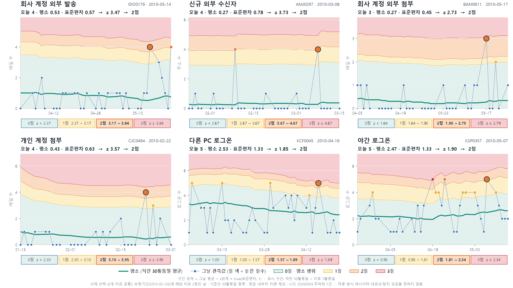
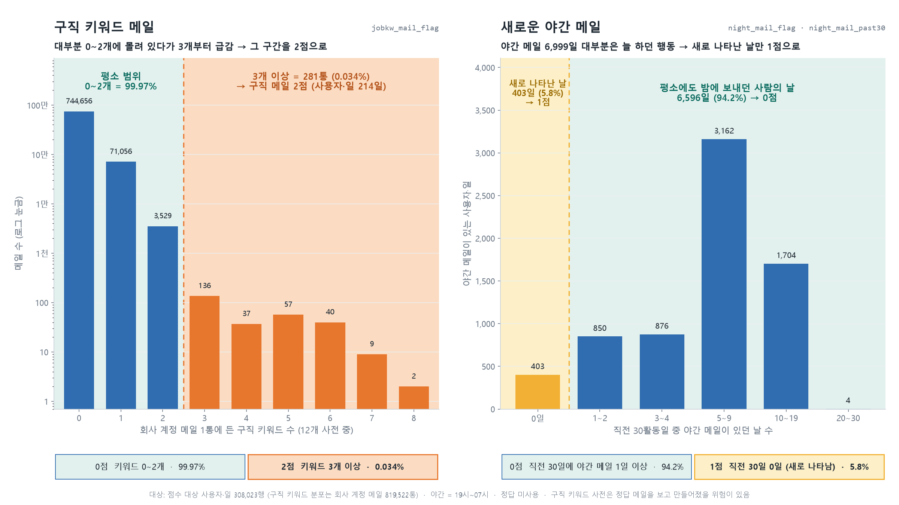
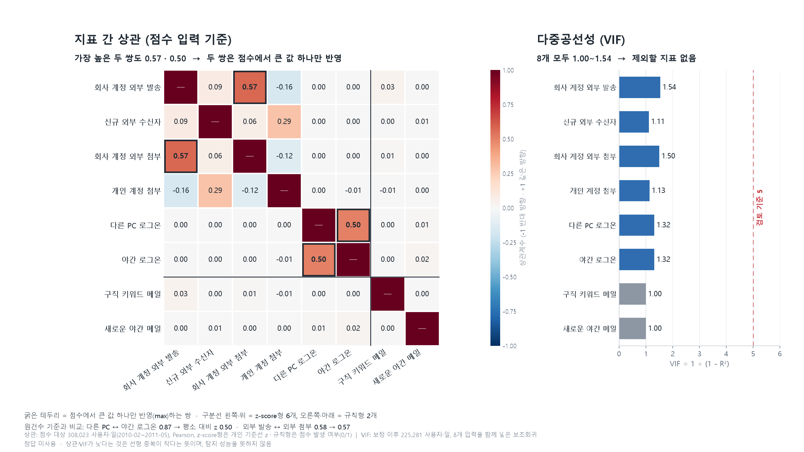

# 02. 행동지표 설계

국내 유출 사고의 행동을 데이터 컬럼으로 옮기고, 세 가지 기준으로 지표 8개를 골랐습니다.

**선정 기준**
1. 국내 유출 사고 행동과 관련이 있을 것
2. 평소와 이상일이 분포에서 구분될 것
3. 지표끼리 겹치지 않을 것 (상관 최대 0.57, VIF 1.00~1.54)

**제외 사례:** 사내 수신자 수 지표는 국내 사고 근거가 약했습니다. 제외 실험에서 탐지는 1명 줄고 비내부자 오탐 사용자는 108명 줄었습니다.

| 파일 | 내용 |
|---|---|
| [indicators_8.md](indicators_8.md) | 최종 지표 8개의 유형과 점수 방식 |
| [indicator_selection_rationale.md](indicator_selection_rationale.md) | 컬럼별 선정·제외 근거 |
| [domestic_incident_evidence.md](domestic_incident_evidence.md) | 국내 유출 사례와 행동 근거 |
| [correlation/](correlation) | 지표 간 Pearson·Spearman 상관, 중복 평가 |
| [internal_recipient_ablation/](internal_recipient_ablation) | 사내 수신자 지표 제외 실험 (계획을 결과 확인 전에 고정) |
| `make_*.py` | README 그림 생성 코드 |

| 규칙형 지표 2개의 분포 | 지표 중복: 상관과 VIF |
|:---:|:---:|
|  |  |
