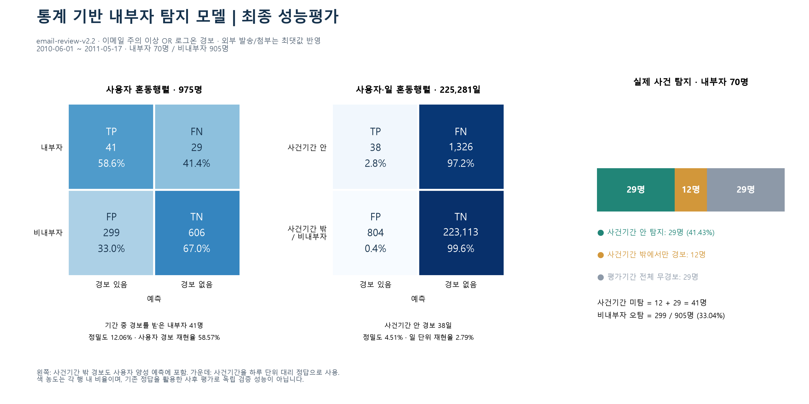

# 04. 평가

확정 정책 `email-review-v2.2`를 CERT r4.2 정답과 사후 대조했습니다.

**평가 설계**
- 보정기간(2010.01~05)과 평가기간(2010.06~2011.05)을 분리했습니다.
- 사건 시작~종료일 안의 경보만 탐지로 인정합니다.
- 평가기간에 활동한 975명(내부자 70명, 비내부자 905명)만 분모로 씁니다.
- 모델 비교는 모두 같은 조사량(842 사용자·일)에서 합니다.

**결과**

| 지표 | 값 |
|---|---:|
| 사건기간 탐지 | **29 / 70명 (41.4%)** |
| 비내부자 오탐 | 299 / 905명 (33.0%) |
| 무작위(같은 조사량, 2,000회) 평균 탐지 | 4.8명 (95% 범위 1~9명) |
| 경보 사용자·일 비율 | 842 / 225,281 (0.37%) |

| 파일 | 내용 |
|---|---|
| [final_evaluation.md](final_evaluation.md) | 최종 성능평가 보고서 (사용자·사용자·일 혼동행렬, 채널·시나리오별 탐지, 한계) |
| [confusion/](confusion) | 평가 스크립트와 요약 지표 CSV |
| [random_baseline/](random_baseline) | 같은 조사량 무작위 기준선 (초기하분포 기대값 + 2,000회 시뮬레이션) |

