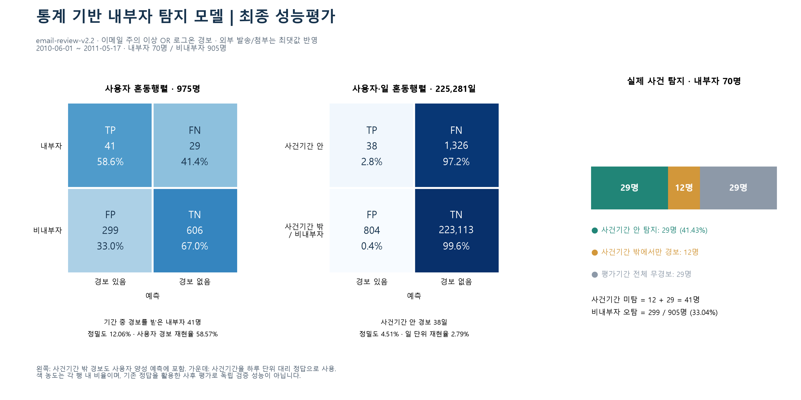

# 통계 기반 내부자 탐지 모델 최종 성능평가

생성: 2026-09-22 17:39:42 (한국시간)  
모델: `email-review-v2.2`  
주 평가기간: **2010-06-01~2011-05-17**  
평가 방식: 고정된 현재 정책을 CERT r4.2 정답과 사후 대조

## 1. 최종 결과

현재 이메일·로그온 통합 조사 대상 기준으로 **사건기간 내 내부자 탐지 29명, 사건기간 내 미탐 41명, 비내부자 오탐 299명**입니다. 반복 경보는 같은 사람으로 중복 계산하지 않습니다.

| 핵심 항목 | 인원 | 비율·기준 |
|---|---:|---|
| 사건기간 내 내부자 탐지 | **29명** | 내부자 70명 중 **41.43%** |
| 사건기간 내 내부자 미탐 | **41명** | 내부자 70명 중 **58.57%** |
| 비내부자 오탐 | **299명** | 평가기간 비내부자 905명 중 **33.04%** |
| 비내부자 무경보 | 606명 | 평가기간 비내부자 905명 중 66.96% |

**주의:** 위 사건기간 탐지와 미탐은 시간 조건을 적용한 사건 탐지 지표입니다. 아래 일반 사용자 혼동행렬은 평가기간 중 한 번이라도 경보가 발생했는지를 기준으로 하므로 TP·FN이 다릅니다. 두 정의를 섞어 하나의 일반 혼동행렬로 제시하지 않습니다.

## 2. 모델과 경보 정책

현재 점수지표는 총 8개이며 이메일 6개, 로그온 2개입니다.

- 이메일 핵심: 회사계정 외부 발송, 신규 외부 수신자, 회사계정 외부 첨부, 개인계정 첨부.
- 이메일 규칙형: 구직 키워드 메일, 새로운 야간 메일.
- 로그온: 다른 PC 로그온, 야간 로그온.
- 외부 발송과 외부 첨부는 **둘 다 점수지표로 유지**하며 개별 z·점수를 계산합니다. 이메일 총점에는 둘 중 **최댓값 하나만** 반영합니다. 동점에도 한 번만 반영하며 추가 1점은 없습니다.
- 이메일은 관심 ≥2점, 주의 ≥3점, 위험 ≥5점입니다.
- 로그온은 두 개별 점수의 최댓값을 사용합니다. 3점이거나, 2점이면서 두 z의 최댓값이 1.9443 이상이면 경보입니다.
- 최종 조사 대상은 **이메일 주의 이상 OR 로그온 경보**입니다. 이메일 점수와 로그온 점수를 더하지 않습니다.

개인 기준선은 당일을 제외한 직전 30개 활동일이며, 점수 대상은 과거 활동일 10일 이상과 첫 활동 후 30일 이상을 충족한 행입니다. z는 `(오늘 값−과거 평균)/max(과거 표준편차,1)`입니다.

## 3. 평가기간과 분모

2010년 1~5월은 z를 개별 1·2·3점으로 바꿀 경계를 정한 **보정기간**입니다. 해당 기간 z 분포의 99%, 99.75%, 99.95% 분위수를 경계로 사용합니다. 6월 이후에는 고정된 경계를 적용합니다. 개인별 직전 30활동일 기준선은 계속 갱신됩니다.

| 구분 | 전체기간 | 보정 이후 주 평가기간 |
|---|---:|---:|
| 점수 대상 사용자·일 | 308,023 | 225,281 |
| 관측 사용자 | 1,000명 | **975명** |
| 정답 내부자 | 70명 | 70명 |
| 비내부자 | 930명 | **905명** |

제외된 비내부자 25명은 모두 마지막 사용자·일 활동 기록이 2010년 6월 이전에 끝나고, 6월 이후 기록이 없습니다. 점수가 낮아서 제외한 것이 아닙니다. 예를 들어 ANM0123은 2010-02-05, AAS0442는 2010-03-12, MAD0496은 2010-05-14, OLB0749는 2010-05-20이 마지막 기록입니다. 평가기간에 기록이 없는 사람을 정상 판정한 TN으로 넣지 않았습니다.

전체 원자료 330,452행 중 기준선 준비 조건을 충족하지 않은 22,429행은 점수 대상에서 제외했으며 정상 0점으로 취급하지 않았습니다.

## 4. 사용자 단위 혼동행렬

**실제 양성:** 정답 내부자 70명.  
**실제 음성:** 해당 기간 관측된 비내부자 905명.  
**예측 양성:** 평가기간에 해당 채널 경보가 한 번 이상 발생한 사용자. 사건기간 밖 경보도 포함합니다.

### 통합 조사 대상

| 실제 \ 예측 | 경보 있음 | 경보 없음 | 합계 |
|---|---:|---:|---:|
| 내부자 | **TP 41명** | **FN 29명** | 70명 |
| 비내부자 | **FP 299명** | **TN 606명** | 905명 |
| 합계 | 340명 | 635명 | 975명 |

| 지표 | 계산 | 결과 |
|---|---|---:|
| 정밀도 | 41 / (41+299) | **12.06%** |
| 사용자 경보 재현율 | 41 / (41+29) | **58.57%** |
| 비내부자 오탐률 | 299 / (299+606) | **33.04%** |
| 특이도 | 606 / (606+299) | 66.96% |
| F1 | 2×41 / (2×41+299+29) | 0.2000 |
| 정확도 | (41+606) / 975 | 66.36% |
| 균형 정확도 | (58.57%+66.96%) / 2 | 62.77% |

41명의 내부자 중 **29명은 사건기간 안에 경보**, 나머지 **12명은 사건기간 밖에서만 경보**를 받았습니다. 따라서 실제 사건 탐지율로 인용할 수치는 **29/70=41.43%**입니다. 58.57%를 사건 탐지율이라고 쓰면 안 됩니다.

사건기간 내 미탐 41명은 **기간 전체 무경보 29명 + 사건기간 밖에서만 경보 12명**입니다.

### 채널별 사용자 혼동행렬 비교

| 채널 | TP | FN | FP | TN | 정밀도 | 사용자 경보 재현율 |
|---|---:|---:|---:|---:|---:|---:|
| 이메일 주의 이상 | 29 | 41 | 270 | 635 | 9.70% | 41.43% |
| 로그온 경보 | 16 | 54 | 43 | 862 | 27.12% | 22.86% |
| **통합 조사 대상** | **41** | **29** | **299** | **606** | **12.06%** | **58.57%** |
| 이메일 위험만 | 3 | 67 | 14 | 891 | 17.65% | 4.29% |

## 5. 사건기간 안의 실제 내부자 탐지

정답자의 사건 시작일~종료일에 경보가 한 번 이상 있어야 탐지 성공으로 계산합니다. 양 끝 날짜를 포함합니다.

| 채널 | 사건기간 탐지 /70명 | 사건 탐지율 | 비내부자 오탐 인원 |
|---|---:|---:|---:|
| 이메일 주의 이상 | 19명 | 27.14% | 270명 |
| 로그온 경보 | 10명 | 14.29% | 43명 |
| **통합 조사 대상** | **29명** | **41.43%** | **299명** |
| 이메일 위험만 | 3명 | 4.29% | 14명 |

이메일과 로그온의 사건기간 탐지자 집합은 이번 데이터에서는 겹치지 않아 19+10=29명입니다. 비내부자 경보는 두 채널에 중복된 14명이 있어 270+43−14=299명입니다.

| 내부자 시나리오 | 전체 인원 | 통합 사건기간 탐지 | 사건 탐지율 |
|---|---:|---:|---:|
| 시나리오 1 | 30명 | 6명 | 20.00% |
| 시나리오 2 | 30명 | 19명 | 63.33% |
| 시나리오 3 | 10명 | 4명 | 40.00% |

## 6. 사용자·일 단위 혼동행렬

하루 단위 평가에서는 **정답 내부자의 사건기간 안 날짜**를 실제 양성으로, 그 밖의 날짜를 음성으로 정의합니다. 단위는 인원이 아닌 사용자·일입니다.

| 실제 \ 예측 | 경보 있음 | 경보 없음 | 합계 |
|---|---:|---:|---:|
| 사건기간 안 | **TP 38일** | **FN 1,326일** | 1,364일 |
| 사건기간 밖 또는 비내부자 | **FP 804일** | **TN 223,113일** | 223,917일 |
| 합계 | 842일 | 224,439일 | 225,281일 |

통합 일 단위 정밀도 4.51%, 재현율 2.79%, F1 0.0345, 오탐률 0.359%, 정확도 99.05%입니다. FP 804일은 비내부자 경보 737일과 정답자 사건기간 밖 경보 67일의 합입니다.

**이 평가는 사건기간을 대리 정답으로 사용합니다.** 사건기간 안의 모든 날짜에 악성 이벤트가 확인되었다는 뜻이 아니므로, 1,326일을 실제 악성 이벤트 미탐 1,326건으로 해석하면 안 됩니다. 또한 오탐은 해당 정답 정의상 오탐이며 실제 업무의 정당성을 건별로 확인한 결과는 아닙니다.

양성 날짜가 0.605%뿐이라 모두 무경보로 처리해도 정확도는 99.39%입니다. 따라서 정확도 99.05%만으로 모델이 우수하다고 평가할 수 없습니다.

## 7. 전체 1,000명 기준 참고 결과

보정기간까지 포함한 전체기간의 통합 사용자 혼동행렬은 **TP 46, FN 24, FP 362, TN 568**입니다. 사건기간 내 탐지 인원은 여전히 29명이며, 전체기간 비내부자 오탐은 **362/930=38.92%**입니다.

| 평가 범위·채널 | 사건기간 탐지 인원 | 비내부자 오탐 인원 | 비내부자 분모 |
|---|---:|---:|---:|
| 보정 이후 · 이메일만 | 19명 | 270명 | 905명 |
| 보정 이후 · 통합 | 29명 | 299명 | 905명 |
| 전체기간 · 이메일만 | 19명 | 335명 | 930명 |
| 전체기간 · 통합 | 29명 | 362명 | 930명 |

**수치 혼동 주의:** 전체기간 오탐 335명은 이메일 채널만의 수치입니다. 이메일·로그온 통합 전체기간 오탐은 362명입니다. 기간과 채널을 함께 명시해야 합니다.

## 8. 성능 해석과 한계

- 현재 모델은 알려진 사건 70명 중 29명을 사건기간 내에 포착하지만 41명을 놓칩니다. 비내부자 905명 중 299명이 한 번 이상 경보를 받아 조사 부담도 남아 있습니다.
- 로그온은 이메일이 놓친 유형을 보완합니다. 통합하면 탐지 범위와 조사량이 함께 늘어납니다.
- 위험 등급만 조사하면 사건기간 탐지자는 3명으로 줄어듭니다. 현재 위험 경계는 5점이며 이 보고서에서 경계를 조정하지 않았습니다.
- 기존 정답을 보고 지표와 점수 정책을 검토한 이력이 있으므로 보정 이후 기간도 완전한 독립 홀드아웃은 아닙니다. 결과는 **현재 확정 정책의 사후 성능평가**입니다.
- CERT 정답은 내부자 시나리오 정답입니다. 특히 시나리오 2의 USB 반출, 시나리오 3의 타인 계정 사용 등이 포함되어 있어 이 결과를 실제 이메일 외부유출 사건의 탐지 성능과 동일시할 수 없습니다.
- 사용자 ID 기준 평가이며, 타인 계정 경보를 실제 행위자에게 귀속하지 않습니다. 같은 사용자의 반복 관측을 독립 표본으로 가정한 유의성 주장은 하지 않습니다.

## 9. 근거와 재현

- 현재 정책·경계·데이터 정보
- [점수 계산 코드](../../src/scoring/scoring.py)
- [채널·기간·평가 단위별 혼동행렬 수치](confusion/confusion_metrics.csv)
- [경보 구성 및 사건기간 밖 경보 분해](confusion/alert_decomposition.csv)
- 사용자별 판정 원장
- 정답자별 사건기간 대조
- [평가 스크립트](confusion/evaluate_confusion.py)
- 평가 입력 해시·검산 기록
- [보고서 이미지 PNG](../../images/confusion_matrix.png) / SVG

검산: 사용자 혼동행렬 합계 975명, 사용자·일 혼동행렬 합계 225,281일, 사건기간 탐지자 29명, 통합 경보 사용자 340명, 통합 경보 사용자·일 842일. 중복 사용자·날짜, 최댓값 점수 집계, 이메일 OR 로그온 경보 논리를 확인했습니다.
