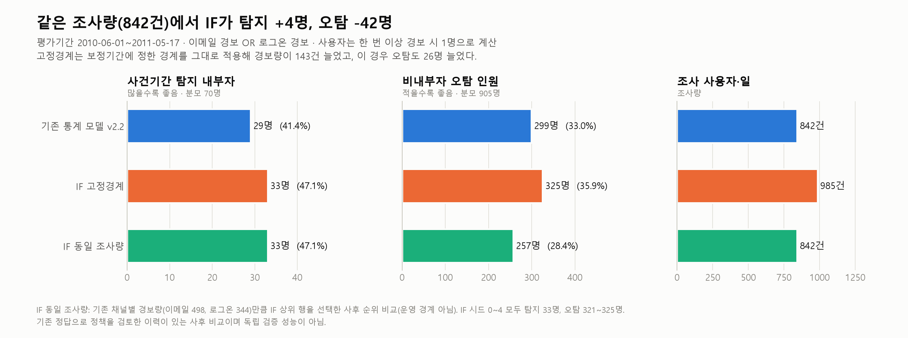
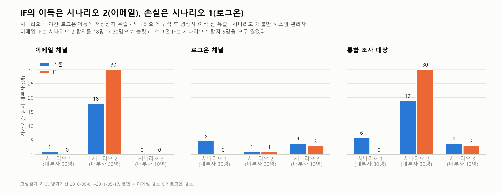
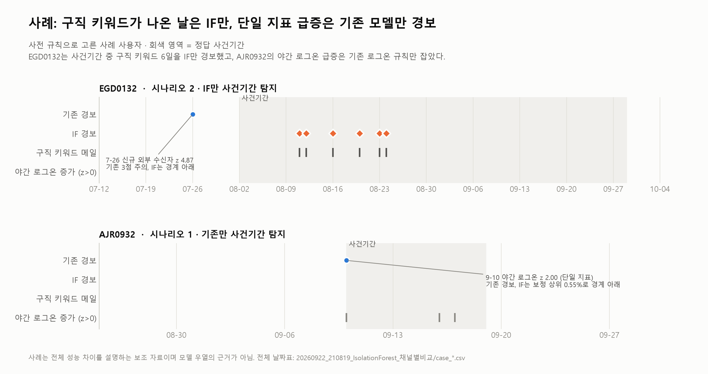

# 05. 모델 비교와 원인 진단

같은 조사량에서 Isolation Forest가 더 좋아 보인 이유를 분해했습니다.

| 모델 (같은 조사량 842 사용자·일) | 사건기간 탐지 | 시나리오 1 / 2 / 3 | 비내부자 오탐 |
|---|---:|---|---:|
| Z-score 규칙 (채택) | 29명 | 6 / 19 / 4 | 299명 |
| Isolation Forest | 33명 | **0** / 30 / 3 | 257명 |

**교차 확인**
1. **경보 분해:** IF만 찾은 11명은 전원 시나리오 2였습니다. IF의 사건기간 이메일 경보 127일 중 123일에 구직 키워드가 있었습니다.
2. **로지스틱 회귀 (해석용):** 구직 키워드의 OR은 416 (95% CI 285~608)입니다. 이 지표를 빼면 pseudo-R²가 0.069에서 0.006으로 떨어집니다. 표준오차는 사용자 단위 군집 보정을 했습니다.

→ 성능 차이는 알고리즘이 아니라 구직 키워드 신호 하나에서 나왔습니다. 설명 가능성과 시나리오 1 탐지를 이유로 Z-score 규칙을 유지했습니다.

| 파일 | 내용 |
|---|---|
| [zscore_vs_isolation_forest.md](zscore_vs_isolation_forest.md) | 두 모델의 상세 비교와 해석 |
| [isolation_forest/](isolation_forest) | 실험 계획, 하이퍼파라미터 고정(정답 미사용 안정성 기준), 평가 코드, 그림 코드 |
| [logistic_regression/](logistic_regression) | 분석 계획, OR·신뢰구간, 구직 키워드 제외 모델, VIF |

| 전체 성능 비교 | 채널·시나리오별 탐지 |
|:---:|:---:|
|  |  |

