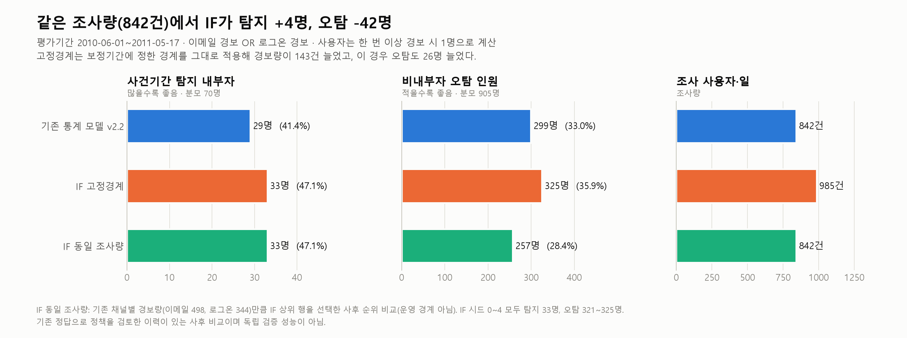
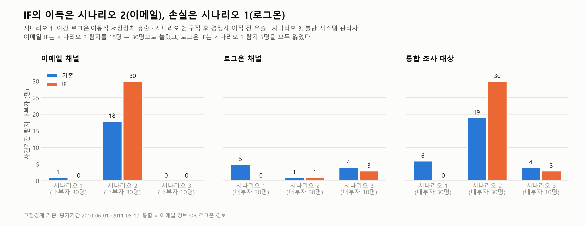
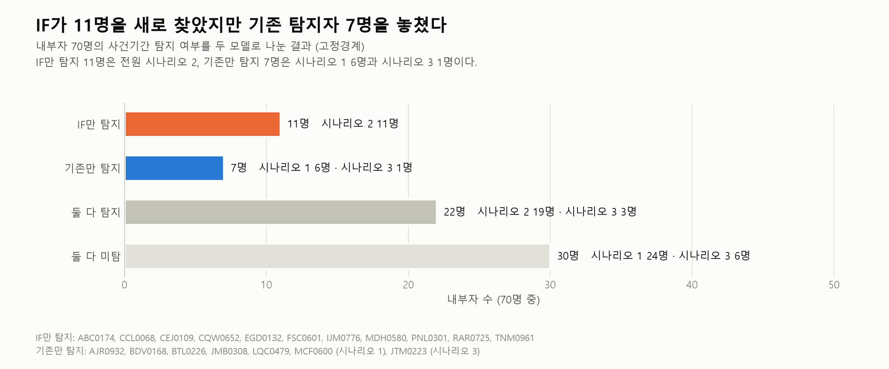
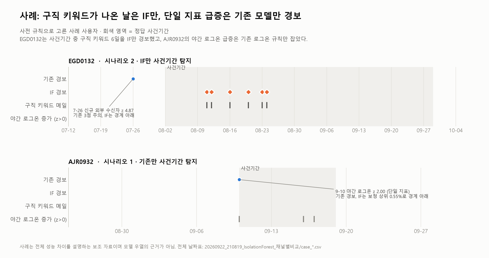

# 기존 통계 모델 vs Isolation Forest 비교 시각화

작성: 2026-09-22 21:44:15 (한국시간)  
데이터: 20260922_210819_IsolationForest_채널별비교의 고정 결과 파일 (새 계산 없음)  
상세 보고서: [20260922_213755_기존점수모델_IF모델_비교_상세.md](../zscore_vs_isolation_forest.md)  
재생성: `python make_figures.py` (PNG 180dpi + SVG)

색 규칙: **파랑 = 기존 통계 모델 v2.2**, **주황 = IF 고정경계**, **청록 = IF 동일 조사량**. 모든 그림에서 같은 색을 같은 모델에 쓴다.

## 1. 전체 성능

같은 조사량 842건에서 IF는 사건기간 탐지 29명 → 33명, 비내부자 오탐 299명 → 257명이다. 고정경계로는 경보량이 985건으로 늘어 오탐도 325명으로 늘었다.

## 2. 채널·시나리오별 탐지

이메일 IF는 시나리오 2 탐지를 18명 → 30명으로 늘렸다. 로그온 IF는 시나리오 1 탐지 5명을 모두 잃었다.

## 3. 내부자별 탐지 변화

IF만 탐지 11명(전원 시나리오 2), 기존만 탐지 7명(시나리오 1 6명, 시나리오 3 1명), 둘 다 탐지 22명, 둘 다 미탐 30명이다.

## 4. 하이퍼파라미터 탐색

정답을 쓰지 않고 시드 안정성과 경보율 이전 오차로 골랐다. 이메일은 16384×1000(S1 0.96), 로그온은 256×1000(S1 0.95)이다.

## 5. 두 모델이 다른 날을 고른 이유

IF만 경보한 날은 구직 키워드(32%)와 새로운 야간 메일(31%) 비중이 높다. 기존 모델만 경보한 날은 개인계정 첨부·외부 발송 같은 건수 지표 급증이 많다.

## 6. 개인 사용자 사례

EGD0132는 사건기간 중 구직 키워드가 나온 6일을 IF만 경보했다. AJR0932는 야간 로그온 단일 급증을 기존 규칙만 경보했다.

## 주의

- 기존 정답으로 정책을 검토한 이력이 있는 사후 비교이며 독립 검증 성능이 아니다.
- IF 동일 조사량은 사후 순위 비교이며 운영 경계가 아니다.
- 색만으로 구분하지 않도록 모든 막대·셀에 수치 라벨을 표시했다. 색약 사용자도 읽을 수 있다.
