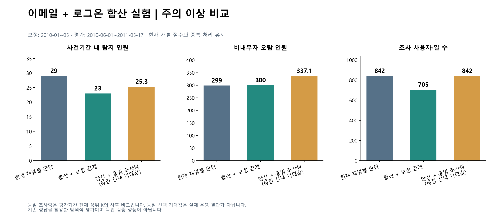

# 06. 채택하지 않은 개선안

겉보기에 더 좋은 숫자를 낸 대안을 검증하고, 채택하지 않은 기록입니다.

**직무 보정 강도 (분할 검증)**
- 사용자 1,000명을 개발용과 평가용 500명씩으로 나누었습니다. 채점 전에 계획과 평가 기준을 파일로 고정하고 해시를 기록했습니다.
- 개발용에서는 w=0.75가 상위 25명 중 내부자 9명(기존 8명)으로 선택됐지만, 평가용에서는 **7명 vs 8명으로 역전**됐습니다.
- 결정: 기존 설정 유지. 1~2명 차이는 우연 범위입니다.

**이메일 + 로그온 점수 합산**
- 같은 조사량에서 탐지 29 → 25.3명, 오탐 299 → 337명으로 모두 나빠졌습니다(동점은 기대값으로 계산).
- 결정: 채널별 등급을 유지하고, 조사 대상은 OR로 정합니다.

| 파일 | 내용 |
|---|---|
| [role_adjustment_split/](role_adjustment_split) | 계획, 결과, 고정 해시, 분할·순위·평가 코드 |
| [channel_merge_decision.md](channel_merge_decision.md) | 채널 통합 논의와 최종 결정 |
| [combined_score/](combined_score) | 합산 점수 실험 계획, 결과, 코드, 요약 CSV |

