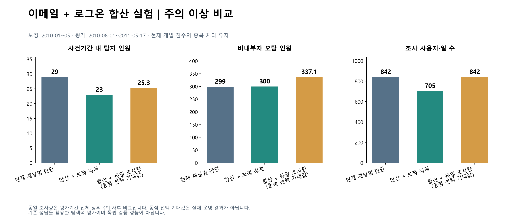

# 이메일·로그온 통합점수 실험 결과

작성: 2026-09-22 · 현재 모델: email-review-v2.2 · 실험 정책: S = 이메일 점수 E + 로그온 점수 L

**판단: 이번에 시험한 단순 합산 방식은 현재 운영 방식을 대체할 근거가 부족합니다. 주의 이상 기준으로 탐지 인원이 29→23명으로 줄고, 비내부자 오탐 인원은 299→300명으로 늘었습니다. 조사량을 842 사용자·일로 동일하게 맞춰도 합산 후보의 기대 탐지 인원은 25.30명, 기대 오탐 인원은 337.13명으로 현행보다 불리했습니다.**

위험 등급에서는 다른 교환관계가 나타났으므로 별도로 보고합니다. 아래 결과를 보고 가중치나 경계를 재조정하지 않았으며, 운영 코드·기본 정책·산출물은 변경하지 않았습니다.



## 1단계. 기존 채널 점수 산출과 검산

현재 8개 지표를 유지합니다. 사내 수신자는 제외되어 있습니다.

```text
E = max(회사 외부 발송 점수, 회사 외부 첨부 점수)
    + 신규 외부 수신자 점수 + 개인계정 첨부 점수
    + 구직 키워드 점수 + 새로운 야간 메일 점수

L = max(다른 PC 로그온 점수, 야간 로그온 점수)
```

이메일 E의 이론상 범위는 0~12점, 로그온 L은 0~3점입니다. 개별 지표의 z 경계, 규칙형 점수와 기존 최댓값 처리를 변경하지 않았습니다. 저장된 모든 점수 대상 행에서 개별 핵심·로그온 점수를 경계로 재계산하고, 규칙형 점수·E·L·로그온 경보·통합 조사 목록이 현재 코드와 일치하는지 검산했습니다.

## 2단계. 통합 점수 후보 정의

```text
S = E + L   (이론상 0~15점)
```

각 채널의 1점을 같은 비중으로 더하는 가장 단순한 후보입니다. 가중치나 추가 보너스는 사용하지 않았습니다. 채널 안의 포함관계 중복은 기존 방식으로 통제하지만, 두 채널 간 관련 행동의 중복을 추가로 해결한 모델은 아닙니다.

## 3단계. 보정기간에서 통합 등급 경계 결정

보정은 2010년 1~5월 중 점수 대상 **82,742 사용자·일**로 수행했습니다. 기준선 준비 조건 때문에 실제 보정 대상 첫날은 2010-02-01입니다. **정답 파일을 열기 전에 경계를 산출·저장했습니다.**

비교 기준은 현재 채널별 판단입니다.

| 등급 이상 | 현행 기준 |
|---|---|
| 관심 | E≥2 또는 L≥1 |
| 주의 | E≥3 또는 현행 로그온 경보 |
| 위험 | E≥5 또는 로그온 위험(L=3) |

현재 로그온 경보는 L=3이거나, L=2이면서 로그온 z 최댓값≥1.9443인 경우입니다. 위험 비교는 이메일만의 위험이 아니라 **어느 채널이든 위험인 경우**를 기준으로 삼았습니다.

관심<주의<위험을 만족하는 모든 정수 경계 조합을 비교해, 세 등급별 현행 경보율과의 절대 오차 합이 가장 작은 조합을 선택했습니다. 동률이면 초과 경보가 적은 조합, 이어 큰 경계를 택하도록 실험 전에 정했습니다. 정답 탐지 인원은 경계 선택에 사용하지 않았습니다.

| 등급 이상 | 현행 보정기간 건수 | 현행 비율 | 선정된 S 경계 | 합산 후보 건수 | 후보 비율 |
|---|---:|---:|---:|---:|---:|
| 관심 | 2,155 | 2.6045% | ≥2 | 1,266 | 1.5301% |
| 주의 | 368 | 0.4448% | ≥3 | 298 | 0.3602% |
| 위험 | 76 | 0.0919% | ≥4 | 26 | 0.0314% |

따라서 후보 등급은 **정상 0~1점 / 관심 2점 / 주의 3점 / 위험 4점 이상**입니다.

**가장 가까운 정수 경계이지, 같은 경보량이 된 것은 아닙니다.** 특히 위험은 보정 경보가 76→26일로 크게 줄었습니다. 위험 경계를 3점으로 낮추면 298일로 증가하고 주의 경계와도 겹칩니다. 정수 점수와 동점이 많아 단일 경계만으로 기존 경보량을 재현하기 어렵습니다. 따라서 다음 단계에서 동일 조사량 비교를 추가했습니다.

## 4단계. 보정 이후 고정 경계 평가

평가기간은 2010-06-01~2011-05-17이며, **225,281 사용자·일 / 975명 / 내부자 70명 / 비내부자 905명**입니다. 모든 정답자는 이 기간에 점수 대상 사건기간 관측이 있습니다.

- 탐지 인원: 자신의 사건기간 안에 경보가 한 번 이상 발생한 내부자 고유 인원.
- 오탐 인원: 평가기간 중 경보가 한 번 이상 발생한 비내부자 고유 인원.
- 경보 건수: 사용자·일 수이며, 같은 사람의 여러 날짜를 각각 계산.
- 정답자의 사건기간 밖 경보는 탐지 성공으로 세지 않으며, 비내부자 오탐과도 구분합니다.

### 주의 이상: 실제 조사 목록 비교

| 항목 | 현재 채널별 판단 | 합산 후보 S≥3 | 변화 |
|---|---:|---:|---:|
| 조사 사용자·일 | 842 | 705 | −137 |
| 사건기간 탐지 인원 | **29** | **23** | **−6명** |
| 사건기간 탐지율 | 41.43% | 32.86% | −8.57%p |
| 비내부자 오탐 인원 | **299** | **300** | **+1명** |
| 비내부자 오탐률 | 33.04% | 33.15% | +0.11%p |
| 비내부자 경보 사용자·일 | 737 | 630 | −107 |
| 사건기간 경보 사용자·일 | 38 | 31 | −7 |
| 정답자 사건기간 밖 경보 사용자·일 | 67 | 44 | −23 |

오탐 경보일은 줄었지만 오탐 고유 인원은 늘었습니다. 반복 경보를 받던 사람의 일부 날짜가 사라지고 새로운 사람의 경보가 추가될 수 있기 때문에 두 수치는 같은 방향으로 움직이지 않습니다.

| 시나리오 | 현재 탐지 | 합산 후보 탐지 |
|---|---:|---:|
| 1 (30명) | 6 | 1 |
| 2 (30명) | 19 | 19 |
| 3 (10명) | 4 | 3 |

사용자·일 혼동행렬은 현재 **TP 38 / FN 1,326 / FP 804 / TN 223,113**, 합산 후보 **TP 31 / FN 1,333 / FP 674 / TN 223,243**입니다. 일 단위 FP에는 정답자의 사건기간 밖 경보도 포함됩니다. 일 단위 정밀도는 4.51%→4.40%, F1은 0.0345→0.0300입니다. 사건기간 전체를 양성으로 쓰므로 실제 악성 이벤트 단위 성능과는 다릅니다.

### 위험: 조사 우선순위 비교

| 항목 | 현재 어느 채널이든 위험 | 합산 후보 S≥4 |
|---|---:|---:|
| 위험 사용자·일 | 173 | 77 |
| 사건기간 위험 탐지자 | 6명 | 9명 |
| 비내부자 위험 경보 인원 | 52명 | 59명 |
| 비내부자 위험 경보 사용자·일 | 143 | 66 |
| 시나리오 1 / 2 / 3 탐지 | 0 / 4 / 2 | 0 / 8 / 1 |

위험 탐지자는 3명 늘지만 오탐 인원도 7명 늘고, 시나리오 3 탐지는 2→1명으로 줄었습니다. 새로 위험 등급에서 탐지한 사람은 5명, 기존 위험 탐지 중 잃은 사람은 2명으로 단순히 기존 탐지에 3명을 더한 것이 아닙니다.

현재 로그온 위험인 **156 사용자·일 중 145일**이 합산 후 주의로 내려갑니다. E=0,L=3이면 S=3이기 때문입니다. 반면 E=4,L=0은 새 경계에서 위험이 됩니다. 즉, 같은 점수를 더해도 채널별 우선순위의 의미가 달라집니다.

## 같은 조사량으로 비교

평가기간 전체에서 현행의 등급별 경보 사용자·일 수 K를 고정하고, 합산 후보 S 상위 K를 선택했습니다. 일별 조사량까지 맞춘 실시간 정책이 아니라 **전체 기간의 동일 예산 사후 순위 비교**입니다.

동점은 라벨과 무관한 균등 비복원 선택을 가정했습니다. 날짜 수는 선택 비율로, 고유 사용자 수는 초기하분포의 ‘한 번 이상 선정될 확률’로 정확한 기대값을 계산했습니다. 따라서 소수 인원은 실제 운영 성과가 아닌 기대값입니다.

### 주의 이상: 842 사용자·일로 고정

S≥3인 705일은 모두 선택하고, S=2인 2,535일에서 137일(5.40%)을 선택해야 합니다.

| 항목 | 현재 방식 | 합산 후보의 동점 선택 기대값 |
|---|---:|---:|
| 조사 사용자·일 | 842 | 842 |
| 사건기간 탐지 인원 | **29명** | **25.30명** |
| 비내부자 오탐 인원 | **299명** | **337.13명** |
| 사건기간 경보 사용자·일 | 38 | 37.38 |
| 비내부자 경보 사용자·일 | 737 | 753.38 |
| 시나리오 1 / 2 / 3 탐지 | 6 / 19 / 4 | 1.43 / 20.76 / 3.11 |

고정 seed의 100회 동점 선택에서는 탐지자가 23~30명, 오탐 인원이 328~349명이었습니다. 이 범위는 신뢰구간이 아니라 동점 선택에 대한 민감도입니다. 가장 좋은 회차를 골라 후보 성능으로 제시하지 않았습니다.

### 위험: 173 사용자·일로 고정

S≥4인 77일을 모두 선택하고 S=3인 628일에서 96일을 선택합니다. 기대 사건 탐지자는 **11.66명(현재 6명)**으로 늘지만 비내부자 오탐 인원도 **118.38명(현재 52명)**으로 늘어납니다. 고정 경계에서 보인 결과를 모든 조사 예산에 일반화할 수 없습니다.

참고로 관심 이상 조사량 5,659일을 맞추면 합산 후보의 기대 탐지 인원은 53.64명(현재 64명), 기대 오탐 인원은 722.92명(현재 651명)이었습니다.

## 왜 합산 방식의 주의 이상 성능이 떨어졌나

### 1. 로그온 2점의 추가 조건을 잃음

현재 모델은 L=2여도 z≥1.9443이면 로그온 주의로 올립니다. 그러나 S=E+L에는 이 추가 조건이 담기지 않습니다. **E=0,L=2인 기존 경보 182일이 모두 S=2의 관심 등급으로 내려갔습니다.** 그중 사건기간 경보는 8일이고, 6명의 내부자가 사건기간 탐지에서 빠졌습니다.

빠진 사람은 시나리오 1의 AJR0932·BDV0168·BTL0226·LQC0479·MCF0600, 시나리오 3의 MSO0222입니다. 예를 들어 AJR0932의 2010-09-10 기록은 E=0,L=2이며 기존 로그온 주의였지만 합산 후 관심입니다.

### 2. 기존 비경보 조합이 새 경보로 올라감

| E | L | 새로 경보가 된 사용자·일 | 사건기간 경보일 |
|---:|---:|---:|---:|
| 1 | 2 | 14 | 0 |
| 2 | 1 | 25 | 1 |
| 2 | 2 | 6 | 0 |

새 경보 45일 중 사건기간 경보는 1일입니다. 그 사람(MOS0047)은 기존에도 다른 사건기간 날짜에 탐지되어 고유 탐지자 수를 늘리지 못했습니다. 결과적으로 182일을 잃고 45일을 얻어 순 경보량은 137일 줄었습니다.

### 3. 정수 합계가 다른 행동 조합을 구분하지 못함

E=2,L=0과 E=0,L=2는 둘 다 S=2입니다. 후자의 일부에는 강화된 로그온 경보 근거가 있지만 단일 합계에서는 구분되지 않습니다. 경계만 움직여서는 이 구분을 복원할 수 없습니다. 이것이 ‘경계를 새로 정하면 합산 문제가 모두 해결된다’고 볼 수 없는 이유입니다.

## 최종 판단과 다음 방향

**이번 단순 합산 후보를 운영 기본안으로 바꾸는 것은 권하지 않습니다.** 실제 조사 기준인 주의 이상에서 사건 탐지자가 줄고 오탐 인원은 늘었으며, 같은 조사량의 기대값 비교에서도 불리했습니다. 위험 등급에서는 탐지·오탐 교환관계가 달라져 별도 우선순위 연구 여지가 있지만 주의 이상 전체 조사 목록의 악화를 상쇄한다고 볼 수는 없습니다.

사용자에게 최종 위험등급을 하나 보여주는 것이 목적이라면, **이메일 등급과 로그온 등급 중 더 높은 등급을 최종 표시 등급으로 사용하는 방법**이 있습니다. 정상<관심<주의<위험 순서로 비교하면 현재 ‘어느 채널이든 주의 이상이면 조사’라는 원칙과 일치합니다. 점수 합산 없이 하나의 최종 등급을 표시할 수 있으며, 채널별 사유를 함께 제시할 수 있습니다. 이번 실험에서는 이를 현행 비교 등급으로만 산출했고 운영 화면은 변경하지 않았습니다.

향후 반드시 숫자 하나로 합쳐야 한다면 로그온의 z 기반 강화 조건과 채널별 위험 의미를 보존하는 새로운 결합 설계가 필요합니다. 이번 결과를 보고 즉석 가점을 더하기보다는 결합 원칙을 먼저 고정하고 미사용 데이터에서 검증해야 합니다.

## 한계와 재현

- 비교 전에 [실험계획](plan.md)을 작성하고 정답을 읽기 전에 보정 경계를 저장했습니다. 다만 프로젝트가 이미 전체 정답을 검토한 이력이 있어 **독립 검증 성능은 아닙니다.**
- ‘정수 경계의 절대 경보율 오차 최소화’와 ‘합산 점수 동점의 균등 선택’이라는 명시한 기준에 대한 결과입니다. 가능한 모든 통합 모델이 부적절하다는 증거는 아닙니다.
- 동일 조사량에서 동점 선택 기대값을 계산한 것은 무작위 조사를 운영 방식으로 권장한다는 의미가 아닙니다. 별도 우선순위 규칙을 도입하면 다른 후보로 평가해야 합니다.
- 비내부자는 정답상 악성 내부자로 지정되지 않은 사람입니다. 실제 업무의 적법성을 개별 확인한 판정은 아닙니다. 같은 사용자의 반복 관측과 사건기간 대리 라벨의 한계가 있습니다.
- [재현 코드](run_experiment.py), [고정 경계 전체 결과](fixed_threshold_metrics.csv), [동일 예산 기대값](equal_budget_expectation.csv), 100회 동점 민감도, 탐지자 변화, 평가 점수 원장, 입력 해시·검산 정보를 함께 저장했습니다.
- [비교 그래프 PNG](../../../images/combined_score_comparison.png) / SVG.
